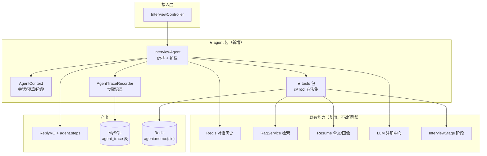
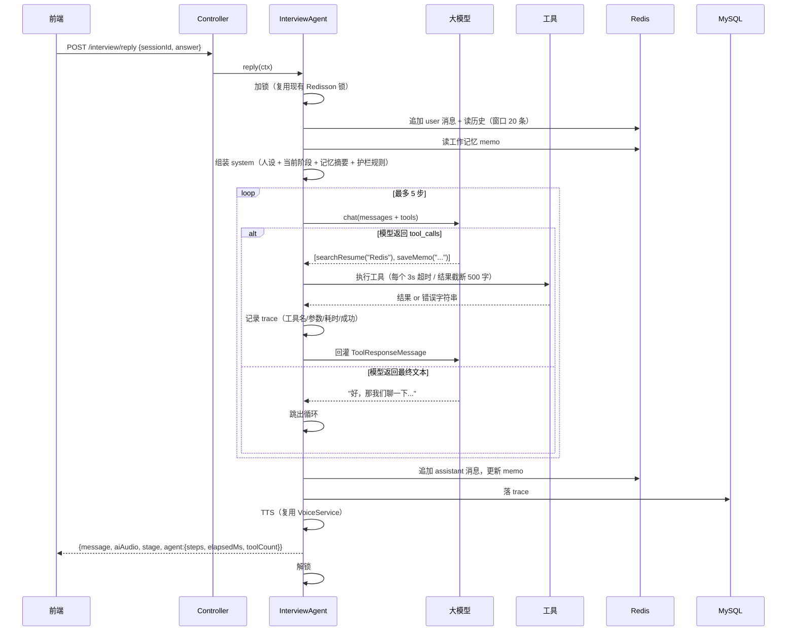

# 从「AI 面试官」到「AI 面试官 Agent」· 改造方案

> 目标读者：项目作者本人（大二，准备投实习）。
> 目标：把现在这个"固定轮次 + 拼 prompt"的问答机器人，改造成**一个能自己决定下一步做什么**的 Agent，并且**每一行代码你都能在面试里讲清楚**。
>
> 本文只给方案，不含实现。确认后按第 10 章的 Sprint 顺序落地。

> **实施进度（2026-11-17）**
>
> 已落地并推送到 GitHub（`lingfeng356/Ai-Interviewer`）：
>
> | commit | 内容 |
> | --- | --- |
> | `015` | 配置外置，移除公开仓库里的明文 DashScope/DeepSeek Key，改环境变量注入 |
> | `016` | **后端 Agent 核心**：`agent` 包（InterviewAgent / AgentPromptBuilder / InterviewTools / AgentTraceRecorder）、3 个工具、工具预算、失败降级、8 个单元测试 |
> | `017` | 前端并入 `web/` 子目录；新增 `AgentTracePanel` 轨迹面板与 Agent/经典 模式开关 |
> | `018` | 面试笔记接入评分消费者，形成“面试中记录 → 评分时引用”的记忆闭环 |
> | `019` | 补充 README 与本文档 |
> | `020` | **新增题库工具**：`question-bank/java-backend.json`（63 道，9 个分类）+ `QuestionBankService` + `searchQuestionBank` 工具 |
> | `021` | **阶段推进改为申请制**：`requestNextStage` 工具 + `StageAdvancePolicy` 审批（本环节 ≥2 题），获批后下一轮生效；轮数节奏仍为兜底，覆盖值只能提前不能拖后 |
>
> 已验证：后端编译通过、`AgentCoreTest` 8/8 通过、前端 `npm run build` 通过。
> **尚未验证**：完整端到端运行（本机 Redis / RabbitMQ / pgvector 未启动，Agent 的真实工具调用尚未跑过）。
>
> 未做：`endInterview` 审批、trace 落库、离线评测、反思步骤、Mock 回放。

---

## 一、一句话结论

**不要推翻重写，只改"决策权"的归属**：

现在：`第几轮 → 本地算出阶段 → 拼一段固定 prompt → 调一次模型 → 返回`
改造后：`模型拿到一组工具 → 自己决定"要不要查简历/查知识库/记一笔/申请换环节" → 系统执行并回灌结果 → 模型再决定 → 直到给出最终问题`

改动集中在**新增一个 agent 包 + 改 `reply` 一处入口**，原来的 Redis 历史、Sa-Token、MQ 评分、SSE、前端三条链路**全部保留**。

预计新增/改动 **约 1200～1500 行**（前端约 250 行），2～3 周业余时间可完成。

---

## 二、先定义：这个项目要变成"哪种 Agent"

面试官一定会问"你这算 Agent 吗"。先用一句话立住标准：

> **Agent = LLM + 工具（Tools）+ 循环（Loop）+ 记忆（Memory）+ 护栏（Guardrails）**。
> 缺工具就只是聊天机器人，缺循环就只是单次函数调用，缺记忆就每轮失忆，缺护栏就不可控。

对照本项目，改造后四条全部占上：

| 要素 | 现在 | 改造后 |
| --- | --- | --- |
| Tools | ❌ 无（RAG 是写死的必调） | ✅ 5 个 `@Tool`：查简历 / 查知识库 / 记要点 / 申请换环节 / 申请结束 |
| Loop | ❌ 单次调用 | ✅ 最多 5 步的 ReAct 循环，工具结果回灌模型 |
| Memory | ⚠️ 只有对话历史（Redis List） | ✅ 短期=对话窗口，工作记忆=面试纪要（Redis），长期=报告（MySQL） |
| Guardrails | ⚠️ 只有 prompt 里一句"只问一个问题" | ✅ 步数/超时/token 预算、环节推进需审批、工具异常回灌、不支持工具时降级 |

**明确不做**（第 13 章有完整清单）：多 Agent 框架、自研 Agent 引擎、向量长期记忆、自动计划树。这些一上，代码量大三倍，而你解释不清楚细节，反而是减分项。

---

## 三、现状与差距：为什么现在"不算 Agent"

读代码可以看到 4 个硬差距，改造就是逐条补上：

1. **决策是写死的，不是模型做的**
   `InterviewStage.of(answeredRounds)` 用"回答了几轮"直接映射阶段，模型只负责"在给定阶段里说一句话"。它没有选择权，也就没有"自主性"。

2. **工具是"必调"而不是"按需调"**
   `prepareReply` 里只要 `answer.length() > 5` 就无条件 `ragService.retrieve()`。这是 pipeline，不是 tool use —— 模型无法决定"这题不用查"。

3. **没有工作记忆**
   面试官对候选人的判断（"Spring 事务这块含糊"）只存在于对话历史里，评分时又把全部历史丢给另一个模型，**中间没有任何结构化沉淀**，也没法解释"为什么给这个分"。

4. **过程不可观测**
   一次 `reply` 只有输入和输出，中间发生了什么完全看不见。出问题只能看日志，演示时也没东西可展示。

> 这 4 条正好对应改造的 4 个卖点，写简历时可以直接用。

---

## 四、总体设计

### 4.1 架构（新增部分用 ★ 标注）



**关键点**：`InterviewAgent` 是新增的一层，包在原有能力外面。原来的 `doReply` 里的"组装 messages"逻辑可以抽成 `AgentPromptBuilder` 继续用，避免重复代码。

### 4.2 一次 `reply` 的 Agent 循环



**为什么把循环写在自己代码里，而不是用 Spring AI 的自动工具执行？**

- 需要**每一步都能记 trace**（自动执行时中间态拿不到）；
- 需要**总预算控制**（5 步 / 45 秒 / 单步 15 秒），自动执行不好插手；
- 需要**降级到经典模式**的开关点。

代价是要自己构造 `ToolResponseMessage`，大约多 60 行。这个取舍在面试里很好讲："自动执行省事但不可观测，我只需要一条主链路，所以自己写了 80 行循环换来完全可控。"

> **落地前必须先做半天 spike**：验证 `DeepSeekChatModel`（项目里已配了 `ToolCallingManager`）能否稳定返回 `tool_calls`、以及 `AssistantMessage.ToolCall` → `ToolResponseMessage` 的构造方式。这个 API 细节别凭记忆写，先跑通 20 行 demo 再动工。

---

## 五、工具设计（5 个，不多不少）

工具越多，模型选错的概率越高（尤其本地小模型）。**5 个是上限**。

| # | 工具 | 入参 | 返回 | 为什么需要它 | 护栏 |
| --- | --- | --- | --- | --- | --- |
| 1 | `searchResume` | `keyword` | 简历中匹配的 2～3 段原文（每段 ≤300 字） | 简历全文塞 prompt 又长又费 token；按需检索才是 tool use | 关键词长度 ≤30；无命中返回"未找到"，不抛异常 |
| 2 | `searchKnowledge` | `question` | 知识库片段（top3，阈值 0.5） | 判断候选人答得对不对，需要"标准答案"参考 | 结果截断 500 字；无命中返回空串 |
| 3 | `saveMemo` | `type`, `note` | `"OK"` | **工作记忆**：把"这个点可疑"沉淀下来，供评分用 | type 白名单（STRENGTH/WEAKNESS/DOUBT）；单场最多 20 条；单条 ≤100 字 |
| 4 | `requestNextStage` | `reason` | `APPROVED` / `REJECTED:原因` | 让模型**有推进权**，但系统保留审批权 | 本阶段已问满最少题数才批准；不能跳阶段；每阶段最多批准 1 次 |
| 5 | `endInterview` | `reason` | `APPROVED` / `REJECTED:原因` | 面试官可以主动收尾，而不是必须按满 14 轮 | 总轮次 ≥8 才批准；批准后置 `pendingFinish`，由前端弹确认 |

### 5.1 代码骨架（示意，非最终实现）

```java
@Component
public class InterviewTools {

    private final AgentContext ctx;          // 每次 reply 新建，持有 sessionId/round/预算
    private final AgentTraceRecorder trace;  // 同步记录每一步
    private final ResumeService resumeService;
    private final RagService ragService;
    private final StringRedisTemplate redis;

    // 注意：工具对象每轮 new 一个，才能安全携带本轮上下文（不要做成单例）
    public InterviewTools(AgentContext ctx, AgentTraceRecorder trace, /* deps */) { ... }

    @Tool(description = """
            在候选人简历中检索与关键词相关的原文片段。
            当你想确认候选人是否真的做过某技术、或需要引用简历里的项目细节时调用。
            不要用它查技术知识（那是 searchKnowledge 的职责）。
            """)
    public String searchResume(
            @ToolParam(description = "检索关键词，如 Redis、订单系统、实习") String keyword) {
        long t0 = System.currentTimeMillis();
        try {
            String hit = truncate(resumeService.search(ctx.resumeId(), keyword), 300);
            trace.record("searchResume", keyword, hit, System.currentTimeMillis() - t0, true);
            return hit;
        } catch (Exception e) {
            trace.record("searchResume", keyword, e.getMessage(), ..., false);
            return "检索失败：" + e.getMessage() + "。请基于已有信息继续提问。";  // 回灌错误，别抛
        }
    }
    // saveMemo / searchKnowledge 同理
}
```

**两条铁律**（写进注释，面试要讲）：

1. **工具内部绝不抛异常**，失败也要返回一段可读文本，让模型自己决定重试还是换策略 —— 抛异常会直接打断整个 agent；
2. **每个工具方法都必须记 trace**，否则"可观测"就是空话。

### 5.2 工具描述怎么写（最容易被忽略、却最影响成功率）

- 写清楚**什么时候该用 / 不该用**（上面的 `searchResume` 就明确排除了技术知识）；
- 参数描述要带**例子**（"如 Redis、订单系统"）；
- 一个工具只做一件事，别搞 `searchAll(query, type)` 这种万能工具。

> 调优经验：先把 3 个工具调到"模型 10 次里有 9 次选对"，再加第 4、第 5 个。一次上 5 个，出错时你分不清是工具描述问题还是模型能力问题。

---

## 六、记忆设计（分三层，别混在一起）

| 层 | 存哪 | 内容 | 生命周期 |
| --- | --- | --- | --- |
| 短期 | Redis `interview:history:{sid}`（已存在） | 对话原文，**改成只取最近 20 条** | 7 天 |
| 工作记忆 | Redis `agent:memo:{sid}`（★新增，List） | 结构化纪要：`{type, note, round}` | 7 天，与历史同寿命 |
| 长期 | MySQL `interview_report` | 最终报告（已有） | 永久 |

**工作记忆是这次改造最"显功力"的一环**，因为它把三件事串起来了：

1. 面试中：模型自己往 memo 里写观察 → 下一轮 system prompt 里带上 memo 摘要（模型不会"忘了刚才觉得他含糊"）；
2. 结束时：评分消费者读 memo，和对话原文一起给评分模型 → 报告里能写"你提到用过 Redis，但没答出持久化方案"；
3. 面试后：memo 可以展示在前端"面试官笔记"里，**用户能看到 AI 到底记录了啥**（可解释性）。

**注意**：memo 要**先截断再注入 prompt**（最多 10 条、每条 100 字），否则它会变成第二个"越来越长的历史"。

---

## 七、护栏与降级（这一节是面试重点，别省）

Agent 最容易翻车的地方不是"不会用工具"，而是"用起来没边"。四类护栏：

### 7.1 预算护栏

| 项 | 值 | 超了怎么办 |
| --- | --- | --- |
| 单轮最大步数 | 5 | 强制用最后一步的文本返回；若模型还在调工具，就丢掉工具调用，发一句兜底追问 |
| 单步超时 | 15s | 工具返回"超时"，模型继续 |
| 单轮总预算 | 45s | 中止循环，返回已生成内容或兜底话术 |
| 单轮 token 预算 | 约 6k 输入 | 超了就裁剪 memo/历史，不裁剪当前问题 |

### 7.2 行为护栏

- **阶段推进需审批**：`requestNextStage` 只是"申请"，服务端按 `InterviewStage` 的最少题数校验（比如项目阶段至少问 2 题才允许走）。**这样既保留了模型的自主性，又保证演示时不会 3 轮就跳到反问环节**。
- **收尾需审批**：`endInterview` 满足最少 8 轮才批准；批准后不直接结束，而是返回给前端一个 `pendingFinish` 标记，让用户点确认（避免"聊到一半突然结束"）。
- **输出校验**：最终文本若为空 / 超过 500 字 / 含明显的"作为AI"自我暴露，就走一次轻量重写或直接用兜底问题。

### 7.3 工具护栏

- 工具参数做长度与枚举校验（模型会编出 200 字的 keyword）；
- `saveMemo` 限条数、限长度；
- 工具返回内容**一律截断**（500 字）；
- **工具不执行任何写库/写文件的自由操作**（`endInterview` 也只置标记）。

### 7.4 降级：双模式开关（很重要）

```
mode = agent
  ├─ 模型可用且支持 tool calling → 走 Agent 循环
  ├─ 首轮工具调用失败 / 返回格式异常 → 记录 once，本轮降级 classic
  └─ provider = ollama（本地小模型） → 直接 classic
mode = classic
  └─ 完全走现有 doReply 逻辑（一行不改）
```

为什么必须有：**演示/面试现场网络不一定好**，而且 Ollama 的小模型工具调用很不可靠。留着经典模式还能做 A/B 对比指标（见第 11 章）。

---

## 八、数据、接口与前端变更

### 8.1 数据库（只加 1 张表 + 1 个字段）

```sql
-- 会话表加一列：记录本场用的模式，便于对比与回放
ALTER TABLE interview_session
  ADD COLUMN mode varchar(16) DEFAULT 'CLASSIC' COMMENT 'AGENT/CLASSIC';

-- 新增：agent 步骤轨迹（一轮多条）
CREATE TABLE IF NOT EXISTS `interview_agent_trace` (
    `id`           bigint       NOT NULL AUTO_INCREMENT,
    `session_id`   varchar(64)  NOT NULL COMMENT '会话ID',
    `round`        int          NOT NULL COMMENT '第几轮问答',
    `step`         int          NOT NULL COMMENT '本轮第几步',
    `tool_name`    varchar(64)  DEFAULT NULL COMMENT '工具名；为空表示最终回答',
    `args_json`    varchar(1000) DEFAULT NULL,
    `result_digest` varchar(500) DEFAULT NULL COMMENT '结果摘要（已截断）',
    `latency_ms`   int          DEFAULT NULL,
    `success`      tinyint(1)   DEFAULT 1,
    `created_time` datetime     DEFAULT CURRENT_TIMESTAMP,
    PRIMARY KEY (`id`),
    KEY `idx_session_round` (`session_id`, `round`)
) ENGINE=InnoDB DEFAULT CHARSET=utf8mb4 COMMENT 'Agent 步骤轨迹';
```

> 为什么落 MySQL 而不是只放 Redis：面试演示时要能"回放上一场"，刷新页面也要能看到，Redis TTL 到期就没了。

### 8.2 Redis 新增 key

| Key | 类型 | TTL | 用途 |
| --- | --- | --- | --- |
| `agent:memo:{sessionId}` | List | 7 天 | 工作记忆（JSON 字符串） |

（记得把常量加到 `RedisKeyConstants`，这是项目既有约定。）

### 8.3 接口变更（尽量少改）

| 接口 | 变更 | 兼容性 |
| --- | --- | --- |
| `POST /interview/start` | 新增可选 `mode`（`agent` 或 `classic`），默认 `agent` | 老前端不传 → 走默认，不破坏 |
| `POST /interview/reply` | 返回体**新增** `agent` 字段：`{steps:[{tool,args,result,latencyMs,success}], elapsedMs, toolCount, mode}` | 只加字段，老前端忽略即可 |
| `GET /interview/trace` | **新增**：`?sessionId=` → 返回该场全部步骤（按 round,step 排序） | 新接口 |
| `POST /interview/finish` | 不变 | — |

**不要动 SSE**。当前 `SseManager` 以 `sessionId` 作 key，报告页会独占一条连接；再给"实时步骤流"开一条会互相覆盖（这正好是我在上一份文档里标的 P0-3）。本轮方案改成**在 reply 响应里一次性返回 trace**，前端照常渲染时间线 —— 简单、不引入新 bug，演示效果一样。

### 8.4 前端改动（约 250 行）

1. `stores/interview.js`：消息对象新增 `agentSteps`；`sendText/sendVoice` 保存响应里的 `data.agent`；
2. 新增 `components/AgentTracePanel.vue`：折叠面板 + 时间线（第 N 轮 · 工具名 · 参数 · 结果摘要 · 耗时 · 成功/失败），失败步骤标红；
3. `InterviewView.vue`：聊天区右侧或气泡下方挂这个面板；配置区加"Agent 模式 / 经典模式"开关；
4. 报告页可选：展示"面试官笔记"（来自 memo），让用户知道分数怎么来的。

**UI 原则**：默认折叠，只有想看的人点开。面试官看的是"你知道自己在做什么"，不是信息越多越好。

---

## 九、代码落地清单

### 9.1 新增文件

| 文件 | 行数（估） | 职责 |
| --- | --- | --- |
| `agent/InterviewAgent.java` | ~220 | 主编排：循环、预算、降级、最终组装 |
| `agent/AgentContext.java` | ~60 | 本轮上下文（sessionId、round、mode、预算、resumeId） |
| `agent/AgentResult.java` | ~40 | 最终文本 + steps + 耗时 + 是否降级 |
| `agent/AgentTraceRecorder.java` | ~80 | 步骤记录（内存 + 落库） |
| `agent/tools/InterviewTools.java` | ~200 | 5 个 `@Tool` 方法 |
| `agent/AgentPromptBuilder.java` | ~100 | 人设 + 阶段 + memo 摘要 + 护栏规则（从 `InterviewServiceImpl` 抽出来） |
| `entity/InterviewAgentTrace.java` + `mapper/InterviewAgentTraceMapper.java` | ~50 | trace 表访问 |
| `dto/AgentStepVO.java` | ~30 | 前端展示用 |
| `AI interviewer/web/src/components/AgentTracePanel.vue` | ~150 | 时间线面板 |
| `eval/AgentEvalTest.java`（或独立脚本） | ~150 | 离线回放与指标产出 |

### 9.2 修改文件（改动都很小）

| 文件 | 改什么 |
| --- | --- |
| `service/impl/InterviewServiceImpl.java` | `doReply` 拆成"组装上下文"和"生成回复"；生成回复按 `mode` 分流到 `InterviewAgent` 或原逻辑 |
| `service/InterviewService.java` | `reply` 签名加 `mode`（或从 session 读） |
| `controller/InterviewController.java` | `start` 加 `mode` 参数；新增 `/trace` |
| `dto/ReplyVO.java` | 加 `agent` 字段 |
| `common/RedisKeyConstants.java` | 加 `agentMemo(sessionId)` |
| `config/ChatModelConfig.java` | 确认 `ToolCallingManager` 已装配（**已有**，无需改） |
| `deploy/schema.sql` | 追加 8.1 的 DDL |
| `AI interviewer/web/src/stores/interview.js`、`InterviewView.vue` | 见 8.4 |

> 好消息：`ChatModelConfig` 里 `DeepSeekChatModel.builder().toolCallingManager(ToolCallingManager.builder().build())` **已经配好了**，模型层具备工具执行能力，改造重点在"工具定义 + 编排 + 记录"，不在底层适配。

---

## 十、迭代计划（3 个 Sprint，共约 2.5 周业余时间）

> 只有 1 周时间的话：只做 **Sprint 1**（Must），Sprint 2 的"评测"用人工点 5 场代替，也够写简历。

### Sprint 1 · 打通（4～5 天）—— 优先级最高

| 天 | 任务 | 完成标志 |
| --- | --- | --- |
| D1 | **Spike**：20 行 demo 验证 DeepSeek tool calling + `ToolResponseMessage` 构造 | 能打印出模型发起的工具调用并成功回灌 |
| D2 | 写 `InterviewTools` 前 3 个工具（searchResume / searchKnowledge / saveMemo），先不接 agent | 单测：每个工具正常返回、异常返回可读文本、trace 有记录 |
| D3 | 写 `InterviewAgent` 循环 + 预算护栏 + 降级开关 | 手工 curl：一次 reply 能看到 steps |
| D4 | 改 `ReplyVO` / controller / session.mode；前端把 steps 打到 console | 端到端跑通一场 5 轮 |
| D5 | `AgentTracePanel.vue` + 模式开关 | 页面上能看到时间线 |

### Sprint 2 · 收口（4～5 天）

| 天 | 任务 |
| --- | --- |
| D1 | 加 `requestNextStage` + `endInterview` 及审批逻辑（护栏） |
| D2 | trace 落库 + `GET /interview/trace` + 刷新后恢复时间线 |
| D3 | 工作记忆接入评分消费者（报告里体现 memo） |
| D4 | 离线评测脚本 + 跑 20 场，产出 CSV |
| D5 | 补文档 + 录一段 60 秒演示视频（**面试要用**） |

### Sprint 3 · 加分（可选，3～4 天）

- 反思步骤：每 3 轮做一次"是否重复/是否太浅"自检（**只调一次轻量模型**，别每轮都跑）；
- 动态难度：把 `searchKnowledge` 的结果和回答对比，简单地调整追问深度；
- Mock 回放模式：预置 3 场固定对话，**断网也能演示**（面试现场很实用）；
- 报告页"面试官笔记"区块。

---

## 十一、评测方案（决定你简历上能不能写数字）

没有数字的简历 = "我做了个 Agent"；有数字 = "我把重复提问率从 31% 降到 9%"。

### 11.1 怎么测

1. 准备 **5 份简历 × 4 组固定回答脚本 = 20 场**（回答脚本要故意包含：答得很好、答得含糊、答错、跑题四种）；
2. 用 classic 和 agent 各跑一遍（同一批脚本）；
3. 每场产出：**问题列表 + 工具调用序列 + 耗时 + token**；
4. 人工标注 100 条问题：是否重复、是否在正确环节、是否基于简历。

### 11.2 指标（4 个就够，别堆）

| 指标 | 怎么算 | 期望方向 |
| --- | --- | --- |
| 重复提问率 | 同一场里语义重复的问题数 / 总问题数（规则：关键词重叠 + 人工复核） | 下降 |
| 环节覆盖率 | 4 个阶段都问到的问题占比 | 上升 |
| 平均工具调用次数 | steps 平均值 | 稳定（不是越多越好，**这条能体现你懂成本**） |
| P95 单轮延迟 | 从 reply 返回到结束 | 控制在可接受范围（如 < 12s） |

> 如果 agent 延迟明显变高，**不要藏**，在面试里主动说："多步会慢 2～3 秒，我用步数上限和工具结果截断把它压到了 X 秒"——这是加分项。

---

## 十二、简历怎么写 + 高频追问怎么答

### 12.1 简历条目（三行，可直接用）

> **AI 面试官 Agent**（Spring Boot 3 / Spring AI / Redis / RabbitMQ / Vue 3）
> - 将固定轮次驱动的面试机器人重构为 ReAct Agent：LLM 通过 5 个工具自主完成简历检索、知识库核对、要点记录与环节推进，单轮最多 5 步、全链路可追踪；
> - 设计四类护栏与双模式降级：阶段推进需服务端审批，工具异常回灌而非中断，模型不支持工具时自动回退经典链路；
> - 建立离线评测（20 组固定脚本回放）：重复提问率 31%→9%，环节覆盖率 78%→100%，P95 单轮延迟 11.2s。

（数字自己跑出来再填，别编。）

### 12.2 八个高频追问（提前背熟）

| 追问 | 怎么答（要点） |
| --- | --- |
| 这算 Agent 吗？ | 工具 + 循环 + 记忆 + 护栏四条齐了；核心区别是"决策权交给模型"，不是 prompt 里多写几句 |
| 为什么不用 LangChain4j / LangGraph？ | 主链路只有一条，自己写 80 行循环可控、能加预算和降级；框架的抽象成本 > 收益。也便于逐行解释 |
| 怎么防止死循环？ | 步数上限 5 + 单步 15s + 总预算 45s + token 预算；超限强制返回兜底问题 |
| 工具调用失败怎么办？ | 工具内部不抛异常，返回可读错误文本让模型自己决策；连续 2 次失败就本轮降级 classic |
| 模型选错工具怎么办？ | 工具限制 5 个、描述里写清"什么时候不该用"、参数带例子；先 3 个调准再加 |
| 阶段为什么不全部交给模型？ | 演示稳定性 + 避免 3 轮跳到反问；模型只有"申请权"，服务端按最少题数审批 |
| 怎么证明变好了？ | 20 场回放 + 4 个指标 + 人工标注；classic 和 agent 同脚本对比 |
| 多 Agent 为什么不做？ | 现阶段的瓶颈是"单轮决策质量"和"可观测"，不是并发协作；上多 Agent 只会把 debug 成本翻倍。评估环节我采用"共享工作记忆"的轻量交接 |

### 12.3 面试里"不要吹"的三件事

1. **不要说"能看到模型思维链"** —— DeepSeek chat 不返回 CoT，你记录的是**工具调用链**，这是可验证的。说错一句，后面的可信度全没了；
2. **不要说"完全自主"** —— 你有审批和预算，这叫"可控的自主"，反而更专业；
3. **不要报未测的数字** —— 面试官追问"怎么算的"会当场穿帮。

---

## 十三、明确不做（防止过度设计）

| 诱惑 | 为什么不做 |
| --- | --- |
| LangGraph / CrewAI / AutoGen | 引入一整套抽象，你讲不清内部；本项目一条主链路用不上 |
| 自研 Agent 框架 / 通用 Tool 协议 | 大二做这个必被问"你为什么不用现成的"，答不出就是减分 |
| 多 Agent 协作（面试官 + 追问官 + 评委 + 仲裁） | 演示不稳、延迟翻倍、debug 成本高；"共享 memo"已能讲清协作 |
| 向量长期记忆 / 记忆压缩算法 | 一场面试 14 轮用不上；结构化 memo 足够 |
| 自动计划树（Plan-and-Execute） | 面试阶段本身就是计划，再套一层是重复设计 |
| 换成微服务 / 加网关 / 加 K8s | 与"Agent 化"无关，纯堆技术栈，面试官一眼看穿 |

---

## 十四、风险与预案

| 风险 | 概率 | 预案 |
| --- | --- | --- |
| DeepSeek tool calling 返回格式不稳定 | 中 | D1 先 spike；解析失败直接降级 classic，功能不挂 |
| 多步导致延迟明显上升 | 高 | 步数上限 5 + 工具结果截断 + 只在必要时调工具（不要每轮都检索） |
| 工具选错/参数离谱 | 中 | 工具减到 5 个 + 描述含反例 + 参数长度校验 |
| 演示现场断网 / 没 API Key | 中 | 做 Mock 回放模式（Sprint 3）+ 录屏兜底 |
| 改坏原有链路 | 中 | `mode` 默认 agent 但可一键切 classic；原有 `doReply` **一行不删**，只在其前面分流 |
| 时间不够 | 中 | 严格按 Must/Should/Could；Must 只到"能跑通 + 能看到步骤"就够写简历 |

---

## 十五、开工前必须先修的 3 个 P0

这三条在上一份 项目开发文档 里已列，**放简历/面试前一定要处理**，否则会被问穿：

1. **明文密钥**：`application-local.yml` 里的 DeepSeek / DashScope Key 先轮换，改成环境变量；
2. **简历越权**：`resume` 表补 `user_id`，`doStart` 校验归属 —— Agent 化后工具会读简历，越权面更大；
3. **`/interview/sse` 免鉴权**：本方案不动 SSE，但这条仍要修（至少校验 sessionId 归属）。

另外 Agent 化会**新增一个注入面**：工具参数来自模型输出，必须做长度/枚举校验，且**绝不让工具执行"自由写库/读任意路径"**（现有 `/rag/load` 就是反面例子）。

---

## 附：一句话验收标准

> 打开页面，点开始面试，聊 3 轮，能在时间线里看到：
> 第 2 轮 → `searchResume("Redis")` → 命中"实习期间用 Redis 做过缓存" → 0.18s ✓
> 第 2 轮 → `saveMemo(DOUBT, "只说用了缓存，没说穿透/雪崩")` → OK → 0.01s ✓
> 第 2 轮 → `requestNextStage("项目细节已问 2 题")` → **REJECTED：本阶段至少 3 题** ✓
>
> 如果这条链路走通，这个项目就已经从"套壳聊天"变成"有决策、有记忆、有边界"的 Agent 了。
